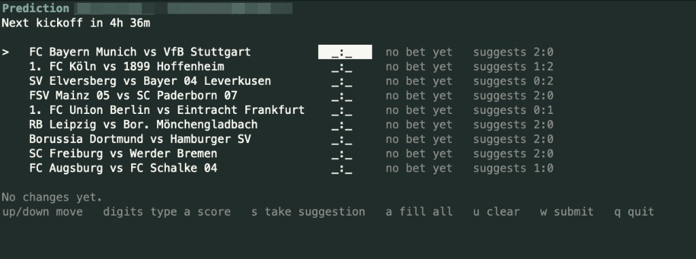

<div align="center">

# kicktipp-agent

**Your [Kicktipp](https://www.kicktipp.com/) prediction pool, from the terminal or your AI assistant.**

[](https://github.com/Skriipt/kicktipp-agent/releases/latest)
[](https://nodejs.org/)
[](https://github.com/Skriipt/kicktipp-agent/actions/workflows/release-mcpb.yml)
[](LICENSE)

[Features](#features) · [Quick start](#quick-start) · [CLI](#cli) · [MCP](#mcp-server) · [Safety](#privacy-and-safety) · [Development](#development)



</div>

`kicktipp-agent` is a local Node.js client for `kicktipp.com` and `kicktipp.de`.
It runs on your machine and talks to Kicktipp over plain HTTP, with no browser
automation.

> [!IMPORTANT]
> This is an unofficial client. Kicktipp has no public API, so website changes
> can break its parsers. Review your tips before submitting them.

## Features

| | |
| --- | --- |
| **Full-screen TUI** | Browse fixtures and place tips with the keyboard. |
| **Scriptable CLI** | Schedules, standings, rules, deadlines, and tipping, with `--json` output. |
| **MCP server** | Lets Claude and other MCP clients read your pool and place tips. |
| **Odds-based suggestions** | `safe`, `ev`, and `contrarian` strategies built on Kicktipp's published odds. |
| **Season analytics** | Stats, rival analysis, standings scenarios, and strategy replays from a local cache. |
| **Reminders** | Desktop, webhook, or command notifications, plus systemd, cron, and `.ics` output. |
| **Audit log and undo** | Every submission is logged locally and can be rolled back. |
| **Multi-account** | Separate profiles for accounts, communities, and players. |
| **Community admin** | Spielleiter tools to place tips on behalf of other members. |

## Quick start

Requires [Node.js](https://nodejs.org/) 20 or newer.

> [!NOTE]
> This fork is not published on npm. The unscoped `kicktipp-agent` package
> belongs to the upstream project, so build from source or use the Claude
> Desktop bundle.

<details open>
<summary><b>Terminal</b></summary>

```bash
git clone https://github.com/Skriipt/kicktipp-agent.git
cd kicktipp-agent
npm install && npm run build && npm link

kicktipp login --web   # private setup page on 127.0.0.1
kicktipp tui           # open the full-screen UI
```

</details>

<details>
<summary><b>Claude Desktop</b></summary>

1. Download [`kicktipp.mcpb`](https://github.com/Skriipt/kicktipp-agent/releases/latest/download/kicktipp.mcpb) from the [latest release](https://github.com/Skriipt/kicktipp-agent/releases/latest).
2. Open it with Claude Desktop and fill in the settings form.
3. Restart Claude Desktop and start a new chat.
4. Ask: *"What is my Kicktipp status?"*

The bundle runs locally. It is not a hosted service.

</details>

<details>
<summary><b>Claude Code and other MCP clients</b></summary>

Build the repository as shown above, then register the server:

```bash
claude mcp add kicktipp -- node /absolute/path/to/kicktipp-agent/dist/server.js
```

Any MCP client can run the same command over stdio. Ask the assistant to set up
your account, then open the localhost URL it returns. Never paste your password
into the chat.

</details>

## CLI

```bash
kicktipp today          # today's matches and open tips
kicktipp deadline       # time until kickoff, tips still missing
kicktipp leaderboard    # current standings
kicktipp bet            # interactive prediction grid
```

Place tips directly, including bonus questions:

```bash
kicktipp bet "FC Bayern München vs Borussia Dortmund=2:1"
kicktipp bet --bonus "Who will win the league?=FC Bayern München"
```

**Prediction grid keys:** `↑↓←→` move · `0-9` enter score · `s` suggest one ·
`a` fill empty rows · `w` submit · `q` quit without submitting.

### Commands

| Area | Commands |
| --- | --- |
| Setup | `login` `logout` `communities` `set-community` `players` `set-player` `profiles` `set-lang` `set-site` |
| Matches and tips | `today` `schedule` `bets` `bet` `tip-status` `deadline` |
| Rankings and rules | `leaderboard` `overview` `table` `rules` |
| Analytics | `sync` `stats` `rival` `suggest` `scenario` `whatif` |
| Automation and history | `remind` `notify` `set-notify` `log` `cache` |
| Other | `tui` `guide` `admin` |

Run `kicktipp <command> --help` for options. The global flags `--community`,
`--profile`, `--lang`, and `--site` override saved settings for a single run.

### Analytics

```bash
kicktipp sync                      # fill the local season cache
kicktipp stats                     # your season statistics
kicktipp rival Papa                # what it takes to overtake a rival
kicktipp suggest --strategy ev     # print a slip, submit nothing
kicktipp whatif suggest:ev         # replay the season with another strategy
```

- `suggest` only prints a slip. Add `--place` to submit it and `--replace` to
  overwrite existing tips.
- Analytics read your community's win/draw point matrix from its rules page.
  Incomplete or unsupported schemes are rejected, never guessed.

### Reminders

```bash
kicktipp set-notify desktop        # or: webhook <url> | command <path>
kicktipp remind --install          # systemd user timer (Linux)
kicktipp remind --print cron       # crontab line
kicktipp remind --ics season.ics   # calendar alarms for every kickoff
```

Desktop notifications support macOS and Linux. On Windows, use the webhook or
command backend with Task Scheduler, or import the `.ics` file.

### Profiles

```bash
kicktipp -c another-pool schedule   # one-off community
kicktipp -p work stats              # separate account and session
```

### History and undo

```bash
kicktipp log          # what was submitted, and when
kicktipp log --undo   # restore the bets replaced by the latest submission
```

Undo covers only the latest successful regular match submission of the signed-in
account. Bonus tips and Spielleiter submissions for other members are skipped.

## MCP server

The server exposes the same data, analytics, and submission logic as the CLI.

| Group | Tools |
| --- | --- |
| Account | `connect_account` `get_status` `get_communities` `set_community` `get_players` `set_player` |
| Matches and tips | `get_today_matches` `get_schedule` `get_bets` `get_deadline` `get_tip_status` `place_bets` `place_bonus_bets` `get_bonus_questions` |
| Rankings and rules | `get_leaderboard` `get_overview` `get_table` `get_rules` |
| Analytics | `sync_history` `get_stats` `get_rival_analysis` `get_standings_scenarios` `suggest_bets` |
| Automation and history | `set_notify` `get_bet_log` |
| Community admin | `list_members` `get_bets_for_member` `place_bets_for_member` |

If setup is incomplete, `connect_account` returns a private localhost URL.

### Read-only mode

```bash
KICKTIPP_READ_ONLY=1 node /absolute/path/to/kicktipp-agent/dist/server.js
```

Read-only mode removes every tool that changes Kicktipp or local settings. It
can also be enabled on the setup page. The CLI and core submission logic reject
writes as well, so safety does not depend on the MCP client behaving correctly.
`connect_account` stays available to save credentials and configuration, but it
cannot submit tips.

## Configuration

Settings and sessions live in `~/.config/kicktipp-agent/`. Cache and audit data
use the platform data directory. Manage the cache with `kicktipp cache status`
and `kicktipp cache clear`.

| Variable | Purpose |
| --- | --- |
| `KICKTIPP_EMAIL` `KICKTIPP_PASSWORD` | Login credentials |
| `KICKTIPP_COMMUNITY` `KICKTIPP_PROFILE` | Default community and profile |
| `KICKTIPP_SITE` `KICKTIPP_LANG` | Site (`de` or `com`) and interface language (`en` or `de`) |
| `KICKTIPP_TZ` | Display time zone (IANA name) for kickoff times |
| `KICKTIPP_READ_ONLY` | Disable all write actions |

Run `kicktipp guide` for the full usage and configuration reference.

## Privacy and safety

- **Local only.** Credentials go solely to the configured Kicktipp base URL. Treat
  a custom `KICKTIPP_BASE_URL` as trusted.
- **No passwords in prompts.** The localhost setup page keeps them out of
  terminal history and chat transcripts.
- **Encrypted storage.** Stored passwords use AES-256-GCM, bound to the local
  hostname and OS user. Session-only mode keeps a login cookie instead.
- **Nothing submitted by accident.** Suggestions are dry runs unless you
  pass `--place`.
- **Respects Kicktipp's rules.** Other players' scores stay hidden until the
  deadline. `tip-status` only reports complete, partial, or missing.

## Troubleshooting

| Problem | Fix |
| --- | --- |
| `node` or `npm` not found | Install Node.js 20+ and reopen the terminal. |
| Setup page does not open | Copy the printed `127.0.0.1` URL into a local browser. |
| Changes not picked up after `git pull` | Run `npm run build`. Clients execute `dist/server.js`. |
| Parsing fails | Retry with `--site de` or `--site com`, then open a sanitized [issue](https://github.com/Skriipt/kicktipp-agent/issues). |

## Development

```bash
npm install
npm run build        # compile TypeScript to dist/
npm test             # run the test suite (Vitest)
npm run pack:mcpb    # build kicktipp.mcpb for Claude Desktop
```

See [CHANGELOG.md](CHANGELOG.md) for release history.

## Credits

This repository is a fork of Christian Heidorn's
[kicktipp-agent](https://github.com/christianheidorn/kicktipp-agent). Thanks to
Christian for the upstream project this version builds on. That project began as
a fork of [schwalle/kicktipp-betbot](https://github.com/schwalle/kicktipp-betbot)
and was later rewritten in TypeScript.

## License

[MIT](LICENSE)
