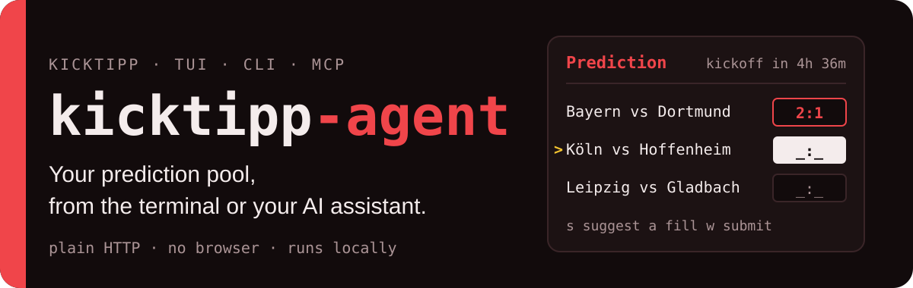

<p align="center">
  
</p>

# kicktipp-agent

A self-hosted service that checks your Kicktipp pools, reminds you about missing tips, and lets your AI assistant read or submit predictions through MCP. Manage accounts and notifications in a local website. No AI subscription is needed for reminders.

[](https://github.com/Skriipt/kicktipp-agent/actions/workflows/ci.yml)
[](LICENSE)

[Quick Start](#quick-start) · [Reminders](#set-up-reminders) · [Connect your agent](#connect-your-agent) · [Limitations](#limitations) · [Service reference](docs/service-reference.md)

## What can it do?

- **Check your pools:** fixtures, saved tips, deadlines, results, rankings, tables and scoring rules.
- **Remind you:** missing match tips and incomplete bonus answers, sent to Discord, Telegram or a webhook. Checks run even when your agent is offline.
- **Work with your agent:** answer questions, suggest a slip from Kicktipp's published odds, and submit regular or bonus tips when you enable writes. Saved tips are checked with a fresh read.
- **Keep accounts separate:** named profiles with their own pools, sessions, reminders and write permissions, all in one container.
- **Go further:** season sync, statistics, submission history, a scriptable CLI, and Spielleiter tools for accounts that already have those rights.

For example, ask your connected agent: **“Which upcoming matches still need my tip?”** Then: **“Suggest a slip and explain it. Don't submit anything yet.”**

**It does not run an AI model, guarantee winning predictions, or place tips just because a reminder is due.** Discord and Telegram receive notifications; they are not chat interfaces to the agent. The local website handles setup and status; predictions are submitted through MCP or the CLI.

## Quick Start

You need [Docker with Docker Compose](https://docs.docker.com/compose/install/), Git, and a Kicktipp account that has already joined a prediction pool.

```bash
git clone https://github.com/Skriipt/kicktipp-agent.git
cd kicktipp-agent
docker compose up -d --build
docker compose exec kicktipp node dist/service/main.js web-token
```

1. Open **http://localhost:8787** on the computer running Docker. Unlock it with the administrator token printed above.
2. In **Account**, name your first profile, enter your Kicktipp login and choose `.de` or `.com`. Click **Sign in and load pools**, select your pool, then **Save**.
3. Open **Overview** to check upcoming matches and bonus questions. Add more pools under **Account** or another account with **Add profile**.
4. Set up [reminders](#set-up-reminders), [connect your agent](#connect-your-agent), or use both.

The website supports English and German. New profiles start **read-only**, with no notification channels or reminder times. Website saves apply immediately. Keep the service running for reminders.

<details>
<summary>Docker is on another computer, or port 8787 is busy</summary>

From your own computer, open an SSH tunnel to the Docker host:

```bash
ssh -N -L 8787:127.0.0.1:8787 your-user@your-server
```

Keep that terminal open, then visit `http://localhost:8787`. Local MCP clients can use the tunnel too. Compose deliberately binds to localhost.

If port 8787 is already in use, start with `KICKTIPP_PORT=8788 docker compose up -d --build` and use port 8788 in your browser, MCP client and SSH forwarding. Keep that setting in a local `.env` file for later Compose commands.

</details>

<details>
<summary>Use the terminal setup instead</summary>

```bash
docker compose run --rm kicktipp setup
docker compose restart kicktipp
```

Follow the prompts for account, pool, permissions and notifications. Unlike the website, a newly created wizard profile suggests reminder times of 24, 6 and 1 hour; you can change them.

This fork is built from this repository. Do not install the unscoped npm package to get this version.

</details>

## Set up reminders

Select a profile and open **Notifications**. Add a destination, choose when to remind you (for example, 24, 6 and 1 hour before the deadline), send a test, then **Save**. Times apply to all destinations and added pools in that profile.

<details>
<summary>Discord — send reminders to a channel</summary>

1. In Discord, open your text channel's **Settings → Integrations → Webhooks**. You need permission to manage webhooks.
2. Create a webhook and copy its URL. No Discord bot is needed.
3. In the local website's **Notifications**, add **Discord** and paste the URL.
4. Choose reminder times, use **Send test message**, check Discord, and **Save**.

Keep the URL private. Mentions are disabled in reminder messages. For forum threads, the URL may need a `thread_id` parameter. [Discord's webhook guide](https://support.discord.com/hc/en-us/articles/228383668-Intro-to-Webhooks).

</details>

<details>
<summary>Telegram — create a bot and find your chat</summary>

1. Message [@BotFather](https://t.me/BotFather), send `/newbot`, and follow its instructions. Keep the bot token private.
2. Open your new bot and send `/start`. For a group, add the bot and send `/start@YourBotUsername` there.
3. From the repository directory, run:

   ```bash
   docker compose run --rm kicktipp setup --notifications
   docker compose restart kicktipp
   ```

4. Select your profile, keep any existing channels, add **Telegram**, and enter the bot token. Leave **Chat-ID** empty to discover your chat, then select it and send a test. Finish the wizard to save.

Already know the chat ID? Add **Telegram** in the website instead, with the token and ID. The website does not discover chats. If another application reads this bot's updates or uses a Telegram webhook, discovery may fail; enter the ID manually. The bot must be allowed to post. [Telegram bot setup](https://core.telegram.org/bots/tutorial).

</details>

<details>
<summary>Webhooks and reminder timing</summary>

Add **Webhook** with a receiver that accepts JSON `POST` requests. Redirects are not followed. See [payload examples and event types](docs/service-reference.md#generic-webhook-payloads).

Use up to ten reminder times, each greater than zero and at most 168 hours; fractions such as `2.5` are supported. The default check interval is 15 minutes, so delivery is approximate. Only missing tips with future kickoffs and editable bonus answers with known future deadlines trigger reminders. Unknown bonus deadlines are shown without inventing a reminder time.

Successful deliveries are remembered across restarts, separately per destination. Failed destinations retry with backoff. Login/check failures also send alerts. A crash after delivery can cause a duplicate. Scheduled summaries currently use German. [Delivery details](docs/service-reference.md#reminder-delivery).

</details>

## Connect your agent

MCP (Model Context Protocol) lets an assistant call this service's tools. Start the service and save a profile first. Open **Connect agent** to reveal the **MCP token**; it is different from the website's administrator token.

| Client setting | Value |
| --- | --- |
| Server URL | `http://127.0.0.1:8787/mcp` |
| Transport | Streamable HTTP |
| HTTP header | `Authorization: Bearer YOUR_MCP_TOKEN` |

**One MCP token can access every configured profile.** Start with `get_status` and `get_profiles`. With multiple profiles, pass the exact returned `profile` ID on every profile-specific call; the website's selection does not select the agent's profile. MCP uses that profile's default pool. [Profile routing](docs/service-reference.md#profile-selection-for-agents).

<details>
<summary>Claude Code — connect locally</summary>

In a terminal on the same computer (or with the SSH tunnel open):

```bash
read -rsp 'Kicktipp MCP token: ' KICKTIPP_MCP_TOKEN; echo
claude mcp add --transport http kicktipp http://127.0.0.1:8787/mcp \
  --header "Authorization: Bearer $KICKTIPP_MCP_TOKEN"
```

Enter the MCP token at the prompt. This saves a credential in your Claude configuration; keep it private. Open Claude Code, check `/mcp`, then ask it to call `get_status` and `get_profiles`. The token belongs in client configuration, never in a chat prompt or committed file. [Official Claude Code instructions](https://code.claude.com/docs/en/mcp).

This recipe is for **Claude Code**. A hosted Claude client needs a reachable HTTPS endpoint and a compatible authentication method; it cannot reach your computer's localhost. Kicktipp provides bearer authentication, not an OAuth server.

</details>

<details>
<summary>Codex — connect locally</summary>

Add this to your user configuration at `~/.codex/config.toml`:

```toml
[mcp_servers.kicktipp]
url = "http://127.0.0.1:8787/mcp"
bearer_token_env_var = "KICKTIPP_MCP_TOKEN"
```

In Bash, enter the MCP token without writing it into shell history, then launch Codex from that terminal:

```bash
read -rsp 'Kicktipp MCP token: ' KICKTIPP_MCP_TOKEN; echo
export KICKTIPP_MCP_TOKEN
codex
```

Check `/mcp`, then ask for `get_status` and `get_profiles`. The environment variable must exist in the process running Codex; a desktop launch does not automatically inherit a terminal's variables. [Official MCP configuration](https://developers.openai.com/codex/mcp).

</details>

<details>
<summary>ChatGPT — a private custom plugin through an OpenAI Tunnel</summary>

Use OpenAI's **Secure MCP Tunnel** to reach your local service without publishing port 8787. You need permission to add custom MCP servers in ChatGPT and access to Platform tunnels; availability depends on your account and workspace.

1. Create a tunnel in [Platform tunnel settings](https://platform.openai.com/settings/organization/tunnels), associate your ChatGPT workspace, and copy the tunnel ID.
2. Install OpenAI's `tunnel-client` on the Docker host.
3. Configure its HTTP target as `http://127.0.0.1:8787/mcp`, with the Kicktipp bearer header supplied locally.
4. In **ChatGPT → Plugins → + → Add custom MCP server**, choose **Tunnel**, select yours, and create and install the plugin.
5. Select it with `@` and ask for `get_status` and `get_profiles`.

**Follow the [copy-and-paste tunnel guide](docs/chatgpt-tunnel.md)** for the exact commands, secret prompts and authentication settings. The tunnel and Kicktipp service must both stay running. This creates a private integration; it is not a public plugin listing. [Official tunnel documentation](https://developers.openai.com/api/docs/guides/secure-mcp-tunnels).

</details>

<details>
<summary>Other MCP clients, remote access and stdio</summary>

Use the URL and bearer header above in any client supporting Streamable HTTP. Retrieve the MCP token locally with `docker compose run --rm kicktipp connection` if needed.

For another computer, use the SSH tunnel above. A hosted client needs an HTTPS route it can reach or a supported private tunnel. If you configure a reverse proxy, preserve `Authorization`; browser clients need their exact origin in `server.allowedOrigins`. Restart after editing the configuration file. Notification webhook URLs are outbound destinations, not MCP addresses.

For stdio-only clients, see [the separate-process instructions](docs/service-reference.md#optional-stdio-clients). Use one Kicktipp process per data volume.

</details>

### Allowing submissions

Enable writes for the intended profile in **Connect agent**. Ask your agent to show its proposed tips before submitting. Submission tools support `dry_run=true` for a preview; on a write-enabled profile, a call without dry run can place real tips. Confirmation behavior depends on your client.

A result of `submission_unknown` means the save could not be fully verified. **Read the saved tips before retrying.** The service does not automatically repeat a submission. Spielleiter actions require existing Kicktipp permissions and retain member confirmation safeguards.

## Limitations

- **Unofficial website client:** supports kicktipp.de and kicktipp.com by reading HTML over HTTP. Website changes can break it. Several MCP matchday inputs are limited to 1–34; not every competition format is covered.
- **Suggestions are estimates:** based on published odds and scoring rules, with generic fallback probabilities when odds are missing. There is no built-in news or injury research. Hidden player scores remain subject to Kicktipp's visibility rules.
- **Self-hosting needs care:** keep the host online. One service process per volume; shared-volume replicas are unsupported. Credentials in `/data/service.json` are plain text protected by file permissions, not encryption.
- **Local access by default:** localhost is private to the host. The MCP token covers all profiles; separate profiles do not restrict a client's account access. Keep credentials and backups private.

## Keep it running

```bash
docker compose ps
docker compose logs --tail=50 kicktipp
docker compose exec kicktipp node dist/service/main.js status
```

An unhealthy login or failed delivery can exist even when Docker reports a healthy container. The website's **Overview** shows those separately.

<details>
<summary>Updates, backups, CLI commands and troubleshooting</summary>

Update from the repository directory:

```bash
git pull --ff-only
docker compose up -d --build
```

Configuration, sessions and history live in the named Compose volume. Back up the entire volume privately while the service is stopped. `docker compose down` keeps it; **`docker compose down -v` deletes it**.

- **Login fails:** check the selected profile's account details in **Account**.
- **No reminder:** check the profile, added pools, destination, reminder times and known deadline. Use **Send test message** to check delivery independently.
- **MCP returns 401:** use the MCP token, not the administrator token. Check that your client sends the bearer header.
- **Profile required:** call `get_profiles` and pass its ID.
- **Tools missing after enabling writes:** reconnect or refresh the client's tool list.

See the [service reference](docs/service-reference.md) for CLI commands, undo limits, health endpoints, storage, migration and development. See also the [changelog](CHANGELOG.md) and [architecture notes](docs/CLAUDE.md).

</details>

## Credits and license

Forked from Christian Heidorn's [kicktipp-agent](https://github.com/christianheidorn/kicktipp-agent), originally based on [schwalle/kicktipp-betbot](https://github.com/schwalle/kicktipp-betbot). Licensed under [MIT](LICENSE).
